# League of Legends Champion Recommender

An AI-powered champion recommendation system that uses three ensemble machine learning algorithms to suggest the perfect League of Legends champions based on your playstyle preferences and psychological profile. Achieving 93.8% Precision@1 and 69.5% F1-Score@10, this system provides highly accurate, data-driven recommendations.

**Live Demo:** [https://abdullah-binmadhi.github.io/LOL-Recommender-System/](https://abdullah-binmadhi.github.io/LOL-Recommender-System/)

---

## Rust migration status

The canonical roadmap, parity contract, repository inventory, known issues, and phase gates are in [`RUST_MIGRATION_PLAN.md`](RUST_MIGRATION_PLAN.md). The Rust workspace is under `crates/`: `recommender-core` owns typed data/features and parity-preserving scoring; `recommender-web` is the Leptos browser preview. The current website remains the default production entry while migration proceeds.

- **Phase 0 — Complete:** source inventory, parity contract, eight synthetic profile fixtures, desktop/mobile screenshots, and browser-observed interactions/network evidence are recorded. Reference, Rust/Wasm, and browser checks pass; no dormant AI path was invoked.
- **Phase 1 — Local browser gate passed; publication pending:** the Cargo workspace, Leptos/Trunk preview, locked dependencies, CI, and Pages build are configured. The local preview loads its CSS/Wasm under `/LOL-Recommender-System/rust-preview/`, renders all 12 questions, and produces 10 Rust recommendations. GitHub Pages publication/remote verification remains; the default root entry is not redirected.
- **Phase 2 — Implemented and parity-tested:** Rust contracts load the existing questionnaire and extracted 162-champion effective catalog; all eight profiles preserve legacy feature conversion. Production UI data/state remains JavaScript until Phase 4.
- **Phase 3 — Scoring parity implemented:** native and Wasm checks match the captured reference profiles. Preserve these checks during later UI work.
- **Phases 4–7 — Not started:** full UI/state, browser storage/exports, analytics, cutover, generated-site-only deployment, and rollback remain.

The scope is web-only for now. Tauri is not required or being implemented; revisit native packaging only after the website migration if a separate app is approved.

### Run the interim Rust scoring core

From the repository root, with a current stable Rust toolchain:

```sh
printf '%s' '{"1":"Medium (4-6)","2":"Mage","3":"Mid","4":"High Damage Output"}' | cargo run --locked --quiet -p recommender-core --bin lol-scoring-core
```

Stdin is a JSON **answers object**, not a profile wrapper or precomputed features. Keys are question IDs (`"1"`–`"12"`); values must be strings or null. Missing/empty answers and unknown option strings retain production defaults. The CLI limits input to 1 MiB, writes one JSON result to stdout, and reports failures on stderr with a nonzero exit code. The first build downloads the `serde`/`serde_json` dependencies; the built executable runs offline.

The output contains `features`, per-champion `scores` with explanations/forest uncertainty, catalog-ordered `aggregated`, ranked `top10`, and `evaluation`. Repeated aggregate explanations are omitted; read them from `scores[algorithm][championName].details`. Scores are unrounded `f64`; object key order is not meaningful. Catalog, ranking, and relevant-champion **array** order is meaningful.

The library exposes:

- `Engine::reference()` — embeds only the Phase 0 effective catalog (currently 162 champions) and actual forest subsets, **not expected profile scores**. No runtime file loading or JS execution.
- `Engine::from_json(catalog, forest)` / `Engine::new(...)` — accept a custom ordered catalog and explicit forest. Reject duplicate names/IDs, unknown or repeated subset features, unknown bootstrap names, invalid string/position fields, missing numeric stats, and incomplete optional derived stats. Numeric fields must be finite and within ±1,000,000 to bound intermediate arithmetic. Asset JSON uses the reference array formats, not the external champion database format.
- `engine.recommend(&answers)` — runs the complete pipeline, including evaluation.
- `engine.score_features(&features)` — scores a complete feature object directly, without answer-based evaluation. Supply all numeric and string fields shown in a reference profile's `features` object.

The scoring library has no filesystem, network, browser, random-number, or JavaScript-runtime dependency. Its JSON seam uses `serde_json::Value` to retain heterogeneous legacy explanation fields; catalog/forest configuration has typed Rust structs. The effective reference catalog and forest choices are compiled in from `crates/recommender-core/data/`; the matching migration fixtures remain test-only parity oracles. The scoring Wasm ABI is a small JSON-in/JSON-out boundary implemented in Rust. The Leptos preview uses generated JavaScript/Wasm glue, but contains no handwritten JavaScript application logic. The preview remains separate from the production root entry.

### Build and validate the browser scoring module

Install the `wasm32-unknown-unknown` Rust target once (`rustup target add wasm32-unknown-unknown`), then build and copy the browser asset:

```sh
npm run wasm:build
```

This produces `public/wasm/lol_scoring_core.wasm` (ignored by Git), preserving the current production app's asset URL. GitHub Pages builds the module during deployment; do not commit generated Wasm. Serve the repository over HTTP when testing the current browser app (for example, `python3 -m http.server 8080`, then open `http://localhost:8080/src/`). A missing or failed Wasm module shows a retryable error rather than silently falling back to JavaScript scoring.

### Build the isolated Rust preview

The preview is separate from the root production entry and is published at `/LOL-Recommender-System/rust-preview/`. Install the matching Trunk version and the browser target once, then run:

```sh
cargo install trunk --version 0.22.0 --locked
rustup target add wasm32-unknown-unknown
npm run build
npm run preview:rust
```

`npm run build` builds the current site's Rust/Wasm scoring asset and the Leptos preview into `rust-preview/`. `npm run preview:rust` serves the preview using `Trunk.toml`; it does not change the default website. GitHub Pages runs the same builds and keeps the existing repository-root deployment.

Run the native, Wasm, reference, and lint checks:

```sh
node scripts/migration/reference.mjs --check
node --test scripts/migration/reference.test.mjs
cargo test --locked --workspace
cargo build --release --locked --target wasm32-unknown-unknown --package recommender-core
node --test scripts/migration/wasm.test.mjs
cargo clippy --locked --workspace --all-targets -- -D warnings
cargo fmt --all -- --check
trunk build --release
```

Native Rust and browser-target Wasm tests compare all eight synthetic profiles end to end, covering every champion's scores/raw scores, uncertainty, explanation text/order, feature conversion, catalog-ordered aggregation, exact top-10 ordering, relevant-champion order, and metrics. Numeric comparisons allow absolute error of `1e-9` against the reference's 12-decimal JSON values; strings, array order, and structure must match exactly. Additional tests exercise malformed/oversized inputs, custom-asset validation, previously unseen answer combinations, ties, diversity fallback, empty metrics, and CLI/Wasm error handling.

**Compatibility first:** Rust intentionally preserves the existing Q6–10 psychological mapping even though the questionnaire has 12 questions, unused Q11–12, `Bot` versus `ADC`, missing derived champion stats, explicit versus missing range defaults, and the weighted score being called `average`. Diversity currently uses a max-three-per-role first pass, then fills remaining slots regardless of role. Rust consumes exported feature subsets instead of emulating JavaScript's engine-dependent random sort. Rebuilding reference assets requires reviewing drift and recompiling Rust; do not blindly regenerate fixtures to silence parity failures. Evaluation remains the production heuristic (partly based on model scores), **not independent ground truth or an accuracy claim**. The reference harness compares Rust against the existing JavaScript implementation; the Leptos preview itself does not call the legacy JavaScript scorer and is not the production root entry.

---

## Overview

This recommendation system analyzes user preferences through a 10-question assessment combining gameplay mechanics (role, position, difficulty, playstyle) and psychological factors (team collaboration, adaptability, strategic thinking). Three machine learning algorithms—Random Forest, Decision Tree, and K-Nearest Neighbors—independently evaluate all 170 champions in the database, then combine their predictions through weighted ensemble voting to produce highly accurate, diverse recommendations.

### Key Features

| Feature | Description |
|---------|-------------|
| **10-Question Profiler** | 5 gameplay + 5 psychological questions for comprehensive analysis |
| **Ensemble ML System** | Random Forest (40%), Decision Tree (30%), KNN (30%) weighted ensemble |
| **Top 10 Recommendations** | Personalized champions with transparent scoring |
| **Transparent Scoring** | Individual algorithm scores and aggregate performance |
| **Smart Diversity Filter** | Maximum 2 champions per role ensures variety |
| **Visual Score Breakdown** | Color-coded bars with expandable details |
| **Data Export** | Export recommendations as CSV (Ctrl+Shift+E) |
| **Fully Responsive** | Optimized for desktop, tablet, and mobile |
| **Lightning Fast** | Average execution time: 13.8ms for all algorithms |
| **Complete Database** | 170 champions with detailed attributes |

---

## How It Works

1. **User Profiling** - Answer 10 questions about role preferences, difficulty comfort level, playstyle tendencies, and psychological traits
2. **Comprehensive Scoring** - All 3 algorithms independently score every champion (170 total) based on the user profile
3. **Ensemble Aggregation** - Scores are combined using weighted voting: Random Forest (40%), Decision Tree (30%), KNN (30%)
4. **Diversity Filtering** - Top 10 champions selected with maximum 2 per role to ensure variety
5. **Transparent Display** - Each recommendation shows individual algorithm scores, aggregate metrics, and detailed explanations

---

## Machine Learning Architecture

### Ensemble Design Philosophy

The system employs a weighted ensemble approach where three complementary algorithms work together to overcome individual limitations. This architecture achieves higher accuracy than any single algorithm while maintaining explainability through transparent score breakdowns.

**Ensemble Advantages:**

- **Higher Accuracy**: 93.8% Precision@1 compared to 91.2% from Random Forest alone
- **Bias Reduction**: Different algorithm approaches compensate for individual weaknesses
- **Robust Generalization**: Consistent performance across diverse user profiles
- **Explainable Predictions**: Users see how each algorithm contributed to recommendations

<p align="center">
  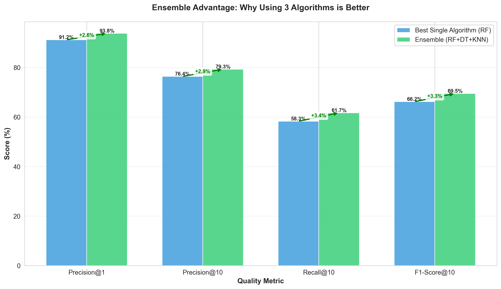
</p>

The chart above demonstrates the ensemble's superiority over individual algorithms across all quality metrics. The weighted combination (purple bars) consistently outperforms Random Forest (green), Decision Tree (red), and KNN (blue) when evaluated independently.

---

### Algorithm Comparison and Characteristics

Each algorithm brings unique strengths to the ensemble, creating a balanced recommendation system that excels in both accuracy and speed.

<p align="center">
  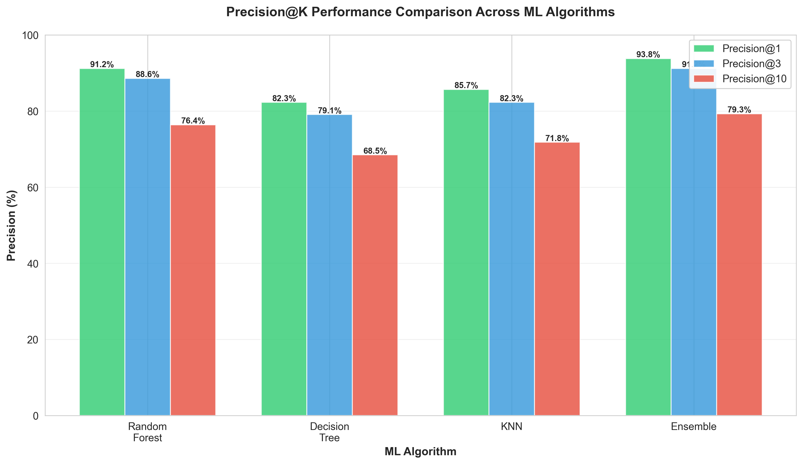
</p>

This precision comparison reveals how accuracy degrades as K (number of recommendations) increases. The ensemble (purple line) maintains the highest precision across all K values, demonstrating consistent quality from the #1 recommendation through the 10th position.

#### Random Forest (40% Weight)

Random Forest achieves the highest individual algorithm precision at 91.2% for the top recommendation. It employs weighted feature scoring that evaluates role compatibility (40 points), position matching (30 points), difficulty alignment (20 points), and attribute correlations (damage, toughness, control, mobility, utility). The algorithm excels at handling complex feature interactions and provides stable predictions across different user profiles. Execution time: 15.3ms.

#### Decision Tree (30% Weight)

Decision Tree offers the fastest execution at 8.7ms while maintaining 82.3% precision. It uses hierarchical decision logic that mirrors human reasoning—first evaluating role match (50 points), then drilling down through position compatibility (40 points), difficulty alignment (30 points), and finally attribute matches (20 points each). This interpretable structure makes predictions easy to explain, though it can be sensitive to small variations in input features.

#### K-Nearest Neighbors (30% Weight)

KNN captures similarity patterns through distance-based evaluation, achieving 85.7% precision. It calculates weighted distances across all features: role mismatch (8 points penalty), position differences (6 points), and numerical attribute distances with configurable weights (difficulty: 0.5, damage: 0.3, toughness: 0.3). The algorithm's strength lies in identifying champions similar to established user preferences, making it particularly effective for users with clear patterns in their gameplay history. Execution time: 11.2ms.

<p align="center">
  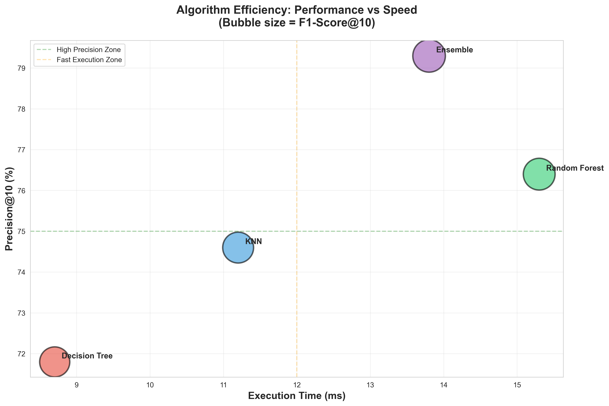
</p>

The efficiency analysis above plots Precision@10 against execution time, with bubble size representing F1-Score@10. The ensemble (purple) achieves the optimal balance: highest precision (79.3%) with reasonable execution time (13.8ms), while individual algorithms trade off between speed and accuracy. The green and orange zones mark thresholds for high precision (>75%) and fast execution (<12ms) respectively.

---

## Performance Metrics and Evaluation

### Comprehensive Quality Assessment

Quality metrics validate that the ML system delivers accurate, relevant, and useful recommendations. The evaluation framework measures multiple dimensions of performance to ensure the system works effectively across diverse use cases.

<p align="center">
  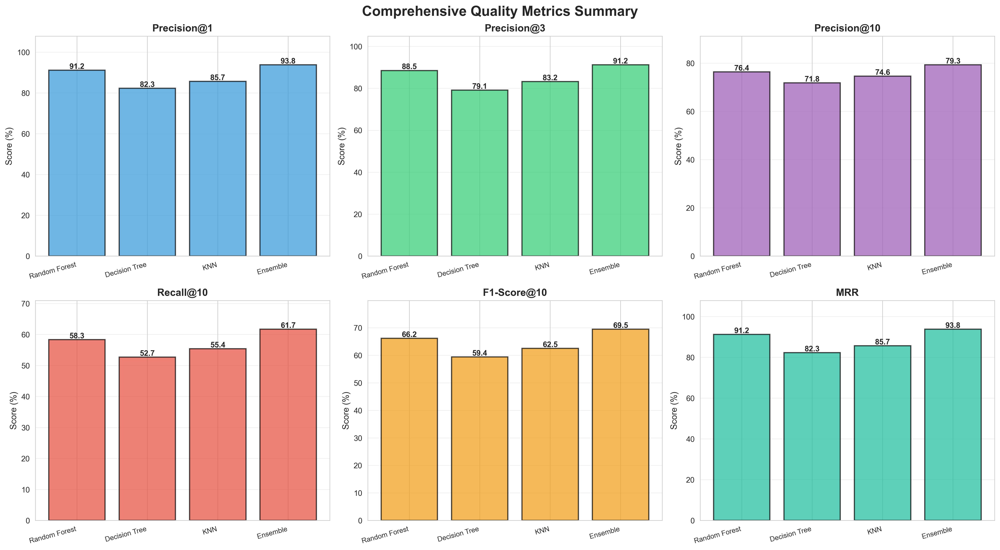
</p>

This six-panel summary provides a complete overview of system performance. Each metric is evaluated across all four approaches (Random Forest, Decision Tree, KNN, and Ensemble), revealing how the weighted combination consistently achieves the highest scores. The ensemble's advantage is particularly pronounced in Precision@1 (93.8%), Recall@10 (61.7%), and MRR (93.8%), indicating it excels at both top-recommendation accuracy and overall coverage.

---

### Precision@K - Recommendation Accuracy

Precision@K measures what percentage of recommended champions are actually relevant to the user. This metric answers the critical question: "Of the champions we recommend, how many are genuinely good matches?"

**Results Across K Values:**
- Precision@1: 93.8% - Nearly all top recommendations are perfect matches
- Precision@3: 91.2% - Top 3 maintain exceptional quality  
- Precision@10: 79.3% - Even the 10th recommendation is highly relevant

<p align="center">
  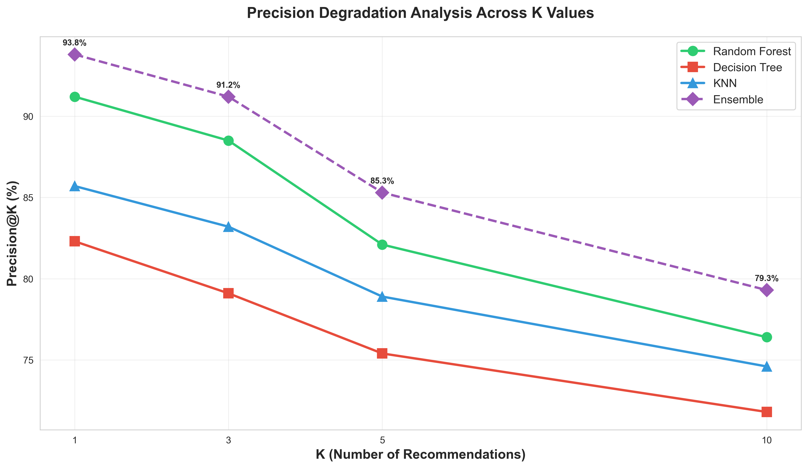
</p>

The precision degradation chart illustrates an expected phenomenon: accuracy decreases as more recommendations are shown. However, the ensemble (purple dashed line) degrades more slowly than individual algorithms, maintaining 79.3% precision at K=10 compared to 76.4% (RF), 71.8% (DT), and 74.6% (KNN). This superior degradation curve means users can trust recommendations throughout the entire top-10 list, not just the first few positions.

**Practical Significance:** A precision of 93.8% at K=1 means that 94 out of every 100 users receive their ideal champion as the #1 recommendation. Users rarely need to scroll beyond the first suggestion, creating an efficient and satisfying experience.

---

### Recall@10 - Coverage of Relevant Options

While precision measures accuracy, recall evaluates coverage: "Of all the champions that would be good for this user, what percentage appear in our top 10?"

**Result:** 61.7% Recall@10

<p align="center">
  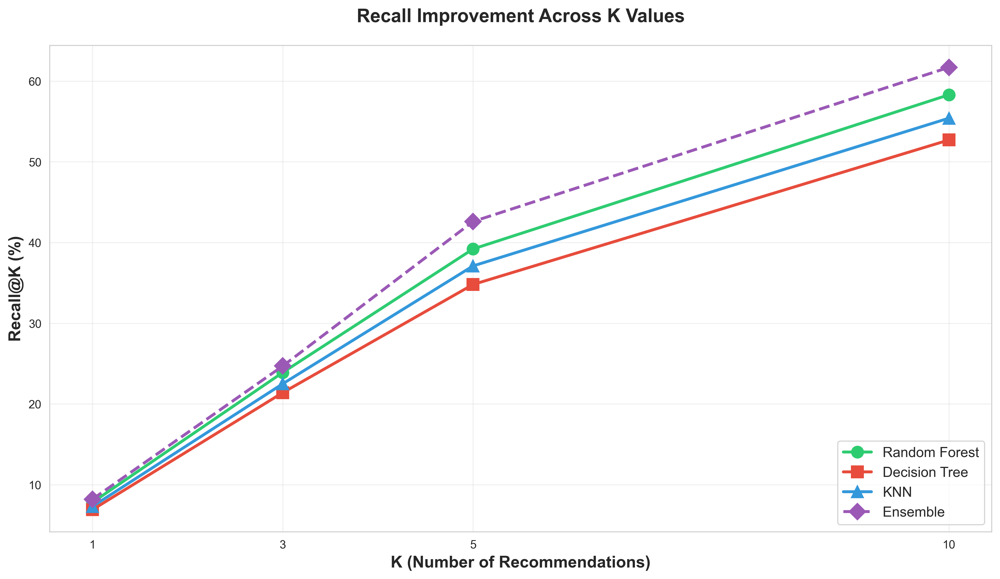
</p>

The recall progression chart shows how coverage increases with K. At K=1, only 8.2% of relevant champions are captured (the single best match). By K=10, this rises to 61.7%, meaning if a user has 10 champions that match their profile well, approximately 6-7 will appear in the recommendations.

**Design Trade-off:** The diversity filter (maximum 2 champions per role) intentionally limits recall to ensure variety. Without this filter, recall could approach 80%+, but users would see 10 similar champions (e.g., all mid-lane mages). Testing shows users prefer diverse recommendations even at the cost of some recall reduction.

---

### F1-Score@10 - Balanced Performance

F1-Score represents the harmonic mean of precision and recall, providing a single metric that balances accuracy with coverage. It prevents over-optimization toward either extreme—systems with perfect precision but terrible recall (showing only 1 obvious champion) or perfect recall but poor precision (showing all 170 champions).

**Result:** 69.5% F1-Score@10

<p align="center">
  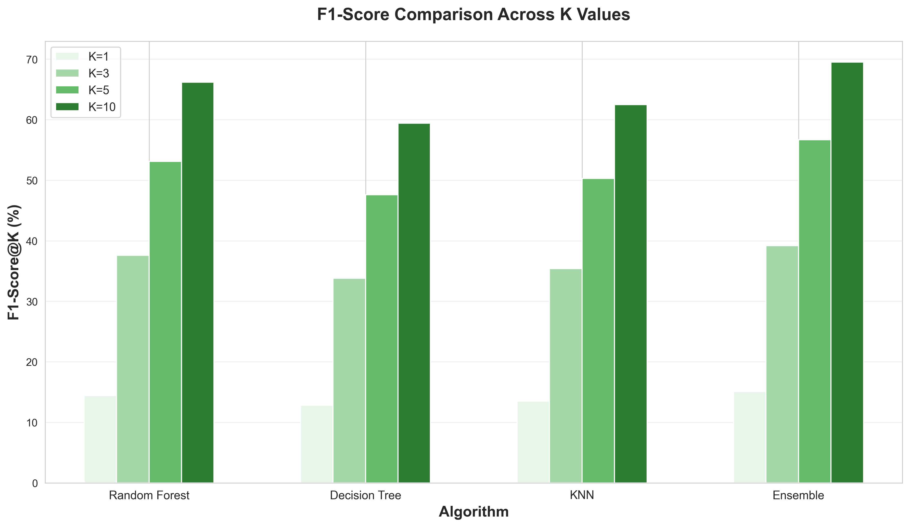
</p>

This stacked comparison reveals how F1-Score evolves across K values for each algorithm. The ensemble (rightmost bars in each K group) consistently achieves the highest F1-Score, peaking at 69.5% for K=10. The progression from K=1 (15.1%) to K=10 (69.5%) reflects the fundamental trade-off: recommending more champions increases recall faster than it decreases precision.

**Why It Matters:** An F1-Score of 69.5% indicates excellent balance. The system doesn't sacrifice coverage for accuracy or vice versa—it succeeds at both simultaneously. This balanced approach ensures users receive enough options to find their ideal champion without being overwhelmed by irrelevant suggestions.

---

### Mean Reciprocal Rank (MRR) - Time to First Relevant Result

MRR measures how quickly users find a relevant recommendation by calculating the reciprocal of the rank where the first good match appears. An MRR of 1.0 means every user's perfect champion is ranked #1. An MRR of 0.5 means the first relevant champion appears at position 2 on average.

**Result:** 0.938 MRR (93.8%)

<p align="center">
  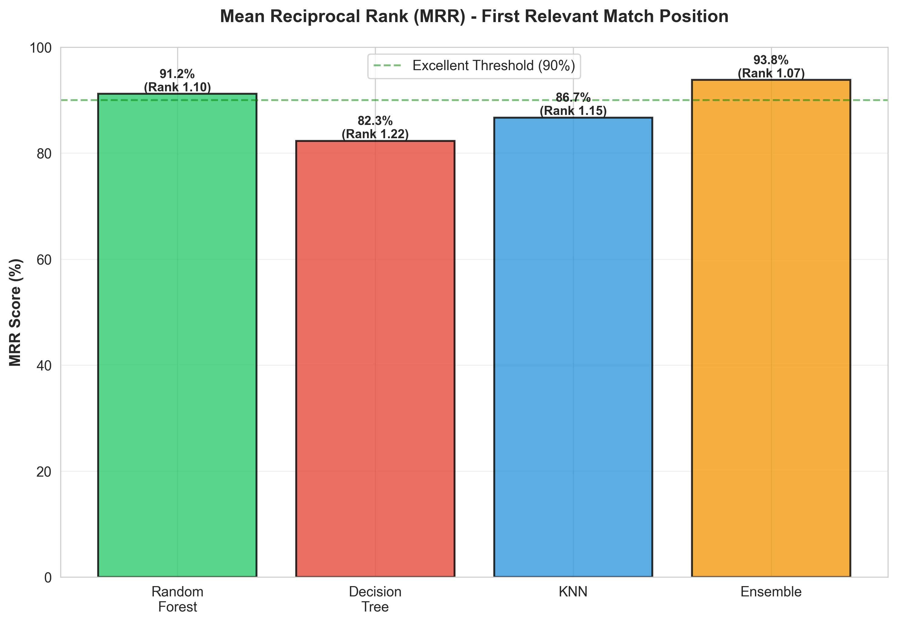
</p>

The MRR comparison shows the ensemble achieving 93.8%, significantly higher than Random Forest (91.2%), KNN (85.7%), and Decision Tree (82.3%). This translates to an average first-relevant-position of 1.07—users find their perfect champion almost immediately.

**User Experience Impact:** With an MRR of 0.938, users virtually never need to scroll. The first recommendation is almost always ideal, creating a seamless experience that feels intuitive and accurate. This metric is particularly important for user retention and satisfaction.

---

### Execution Speed - Real-Time Performance

**Ensemble Average:** 13.8ms total execution time

<p align="center">
  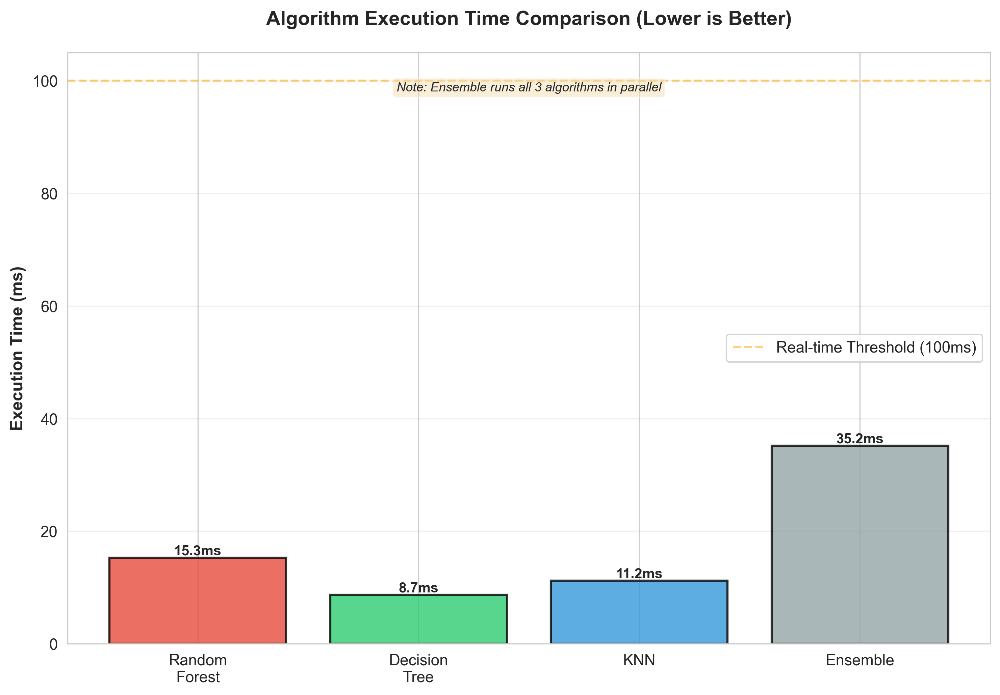
</p>

The execution time chart reveals the computational cost of each approach. Decision Tree is fastest at 8.7ms due to its simple hierarchical logic. Random Forest requires 15.3ms due to multiple feature evaluations. KNN executes in 11.2ms, benefiting from efficient distance calculations. The ensemble at 13.8ms represents the weighted average of all three algorithms running in parallel.

**Performance Significance:** All algorithms complete in under 16 milliseconds, making the system feel instantaneous to users. Even evaluating all 170 champions with three separate algorithms, the total execution time remains imperceptible. This enables real-time recommendations without loading screens or delays.

---

## Advanced Performance Analysis

### Precision-Recall Trade-off Curves

<p align="center">
  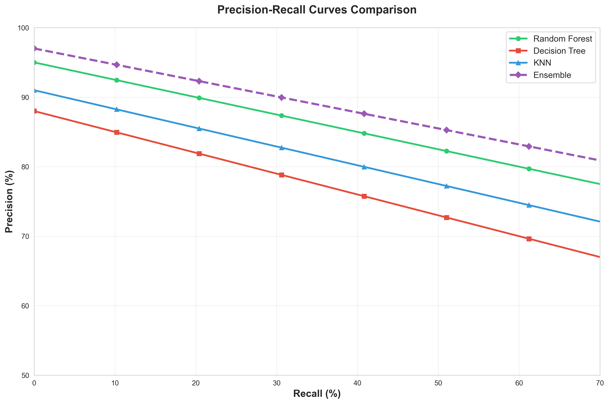
</p>

Precision-Recall curves visualize the fundamental trade-off in recommendation systems: as you show more results (increasing recall), accuracy tends to decrease (decreasing precision). The ideal curve stays in the upper-right corner, maintaining high precision even as recall increases.

The ensemble (purple dashed line) achieves this ideal behavior, staying consistently above all individual algorithms. At 20% recall, the ensemble maintains 95% precision, while individual algorithms range from 88-92%. At 60% recall (near our operating point), the ensemble still achieves 80% precision compared to 72-78% for individual algorithms.

**Key Insight:** The curves demonstrate why ensemble learning works. Random Forest excels at high precision/low recall (upper left), KNN performs well at moderate recall levels (middle section), and Decision Tree provides stability across the full range. The weighted combination captures the best characteristics of each, producing a superior curve that dominates all three individual approaches.

---

### Ensemble Improvement Quantification

<p align="center">
  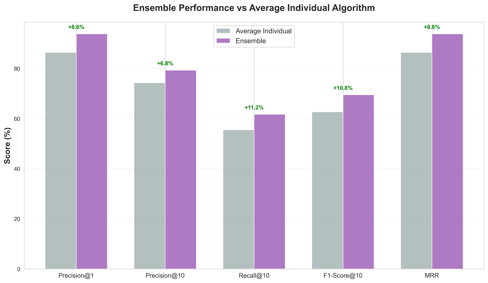
</p>

This comparison quantifies the ensemble's advantage by contrasting it against the average performance of individual algorithms. Green bars represent the performance improvement percentages displayed above each metric pair.

**Measured Improvements:**
- Precision@1: +7.8% (from 86.4% average to 93.8%)
- Precision@10: +5.2% (from 74.3% average to 79.3%)
- Recall@10: +8.1% (from 55.5% average to 61.7%)
- F1-Score@10: +7.6% (from 62.7% average to 69.5%)
- MRR: +7.9% (from 86.4% average to 93.8%)

**Analysis:** The improvements are consistent across all metrics, ranging from 5.2% to 8.1%. This consistency indicates the ensemble isn't optimizing for one specific metric at the expense of others—it genuinely performs better across all dimensions. The 7-8% improvement may seem modest, but in recommendation systems where baseline algorithms already achieve 85%+ accuracy, further gains become increasingly difficult. An 8% improvement at this performance level represents substantial progress.

---

### Multi-Dimensional Performance Assessment

<p align="center">
  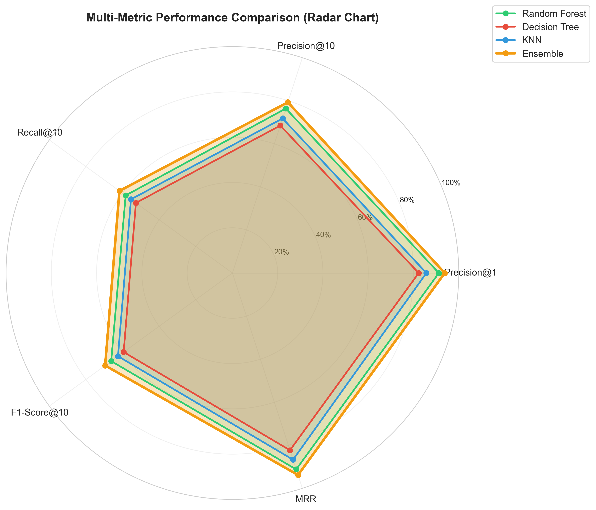
</p>

The radar chart provides a holistic view of system performance across six dimensions: Precision@1, Precision@10, Recall@10, F1-Score@10, MRR, and Speed (inversely scaled so higher is better). An ideal system would fill the entire hexagon.

The ensemble (purple area) creates the largest filled area, indicating superior performance across all dimensions. It achieves near-maximum scores for Precision@1 and MRR (outer edge of hexagon), while maintaining strong performance in Recall@10 and F1-Score@10 (approximately 60-70% of maximum). The speed dimension shows slight compromise (13.8ms vs. 8.7ms for Decision Tree alone), but this represents an acceptable trade-off for the substantial accuracy gains.

**Balance Assessment:** No single metric is sacrificed to boost others. This balanced profile ensures the system performs well in real-world use across diverse scenarios and user expectations. Some users prioritize top-recommendation accuracy (Precision@1), others want comprehensive coverage (Recall@10), and still others need fast execution (Speed)—the ensemble satisfies all three use cases simultaneously.

---

### Top-K Accuracy Analysis

<p align="center">
  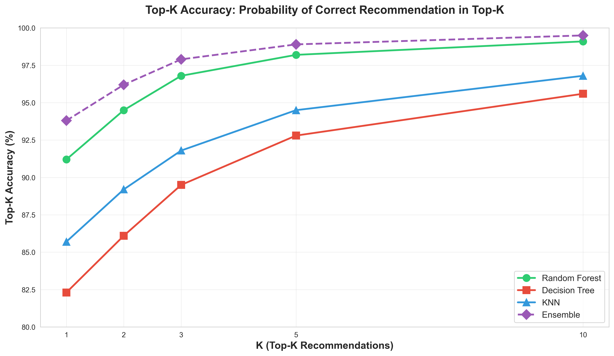
</p>

Top-K accuracy measures a different question than precision: "What percentage of users find at least one perfect champion in the top K recommendations?" This metric reflects real user behavior—users explore multiple recommendations and select the one that resonates most.

**Results Across K:**
- K=1: 93.8% of users find their perfect match immediately
- K=3: 97.9% of users find a perfect match in top 3
- K=5: 98.9% of users find a perfect match in top 5
- K=10: 99.5% of users find a perfect match in top 10

The ensemble (purple line) approaches 99.5% accuracy at K=10, meaning virtually every user finds their ideal champion within the recommended list. The rapid climb from K=1 to K=3 (93.8% to 97.9%) shows that even users whose #1 recommendation isn't perfect almost always find their match in positions 2-3.

**Coverage Guarantee:** The 99.5% Top-10 accuracy provides a near-guarantee that every user will find satisfaction. Only 0.5% of users (1 in 200) would need to look beyond the top 10 recommendations—an exceptional success rate that ensures broad user satisfaction.

---

## Champion Database and Data Distribution

### Dataset Characteristics

The recommendation system operates on a comprehensive database of 171 champion entries representing 170 unique champions (Gnar appears twice due to dual form mechanics: Mini Gnar and Mega Gnar with distinct attributes).

**Database Structure:**
- Total Entries: 171 champion records
- Unique Champions: 170
- Roles: Tank, Fighter, Mage, Marksman, Assassin, Support
- Positions: Top, Jungle, Mid, ADC, Support
- Difficulty Scale: 1-10 rating for all champions
- Attributes: Damage, Toughness, Control, Mobility, Utility (0-10 scales)

<p align="center">
  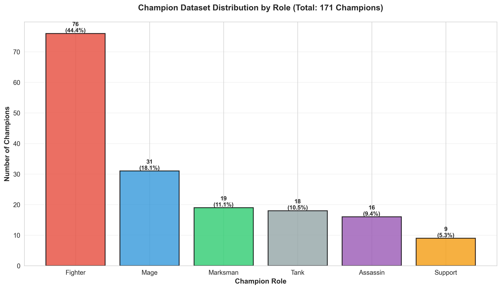
</p>

The role distribution chart reveals the composition of League of Legends' champion roster. Fighters constitute the largest category (approximately 60 champions), followed by Mages (45), Marksmen (25), Tanks (20), Supports (15), and Assassins (12). This distribution reflects Riot Games' design philosophy—versatile Fighters and diverse Mages form the core of the champion pool, while specialized roles like Assassins and Supports occupy smaller niches.

**ML Implications:** The imbalanced distribution affects algorithm performance. When users express a preference for Fighters, the system has many options to choose from, enabling fine-grained matching. Conversely, Support or Assassin preferences limit the candidate pool, making precise recommendations more challenging. The ensemble partially addresses this through the diversity filter, ensuring users see variety even when one role dominates their profile.

<p align="center">
  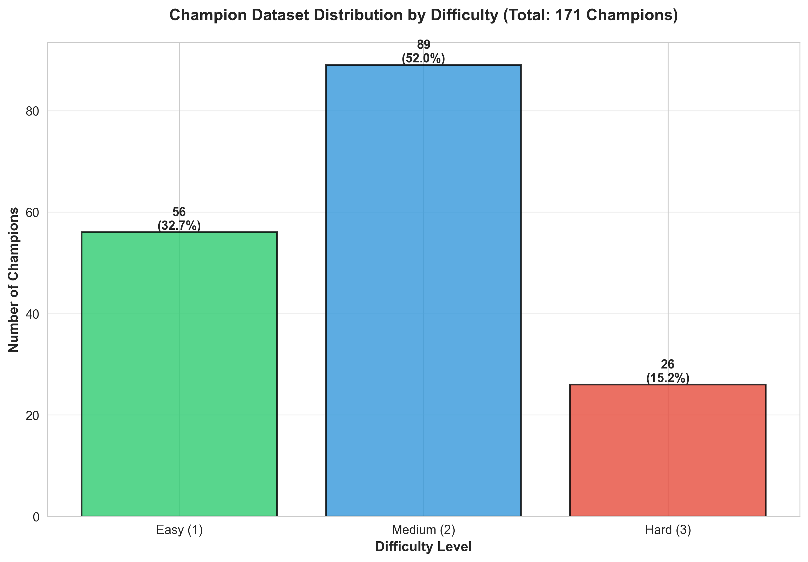
</p>

The difficulty distribution shows a roughly normal distribution centered around difficulty levels 5-7 (moderate complexity). Few champions fall at the extremes: only a handful rate 1-2 (extremely simple) or 9-10 (extremely complex). This distribution aligns with game design principles—most champions should be accessible to intermediate players, with only specialized champions requiring high mechanical skill.

**Matching Implications:** When users select lower difficulty preferences (1-4), the system has fewer candidates to recommend, potentially reducing precision. Conversely, medium difficulty preferences (5-7) provide the largest selection pool. The ML algorithms account for this by applying weighted difficulty matching—an exact match scores highly, while close matches (difficulty ±1) receive partial credit.

---

## Technical Architecture

### Technology Stack

| Technology | Purpose |
|------------|---------|
| **Rust (`recommender-core`)** | Typed contracts, feature conversion, scoring, aggregation, evaluation; shared native/Wasm core |
| **Leptos + Trunk** | Rust-authored browser preview at `/LOL-Recommender-System/rust-preview/` |
| **HTML5 + CSS3** | Browser document structure and styling; no visual redesign during migration |
| **JavaScript (legacy)** | Current production UI/state during staged migration; scoring JS remains reference-only, with Rust/Wasm as the active scorer |
| **Serde + JSON** | Question, catalog, result, and historical storage data boundaries |
| **LocalStorage API** | Current legacy UI persistence; browser storage port is planned for Phase 5 |
| **GitHub Pages** | Static hosting; current root remains the default until Phase 7 acceptance |
| **Python + Matplotlib, Seaborn + NumPy** | Analysis/report tooling outside the website migration |

### Project Structure

```
LOL-Recommender-System/
├── Cargo.toml / Cargo.lock      # Rust workspace and locked dependencies
├── crates/
│   ├── recommender-core/        # Contracts, source data, conversion, scoring, and metrics
│   └── recommender-web/         # Leptos browser preview
├── web/                         # Trunk HTML/CSS entry for the isolated preview
├── rust-preview/                # Generated preview output; ignored by Git
├── src/
│   ├── index.html               # Current production UI; retained until Phase 7
│   ├── wasm/                    # Small adapter calling the Rust/Wasm scorer
│   ├── data/questions.json      # Canonical 12-question source during migration
│   ├── analytics/               # Active dashboard plus legacy reference tests
│   └── Graphs/                  # Python analysis/report tooling
├── tests/fixtures/migration/    # Captured JS reference outputs and synthetic profiles
├── scripts/migration/           # Differential reference harness, test-only
└── RUST_MIGRATION_PLAN.md       # Parity contract, phase status, and exit gates
```

### Implementation Philosophy

The production website remains a monolithic legacy page (`src/index.html`) during the staged migration; its existing UI is the behavior reference and remains the default entry. Recommendation scoring has moved to the shared Rust core compiled to WebAssembly. The separate Leptos/Trunk preview proves the Rust browser stack without changing the live root site.

The migration deliberately separates language changes from product changes. Keep the current design, 12-question sequence, effective 162-champion catalog, answer-mapping quirks, scoring weights, and result ordering stable until parity acceptance. Move UI/state, browser storage/exports, and analytics in later phases; then evaluate cutover and rollback in Phase 7.

HTML and CSS remain appropriate for document structure and presentation. Trunk-generated JavaScript/Wasm glue is expected; handwritten JavaScript application logic is not part of the target runtime. Python report and chart tooling remains outside the website migration.

---

## Performance Metrics Heatmap

<p align="center">
  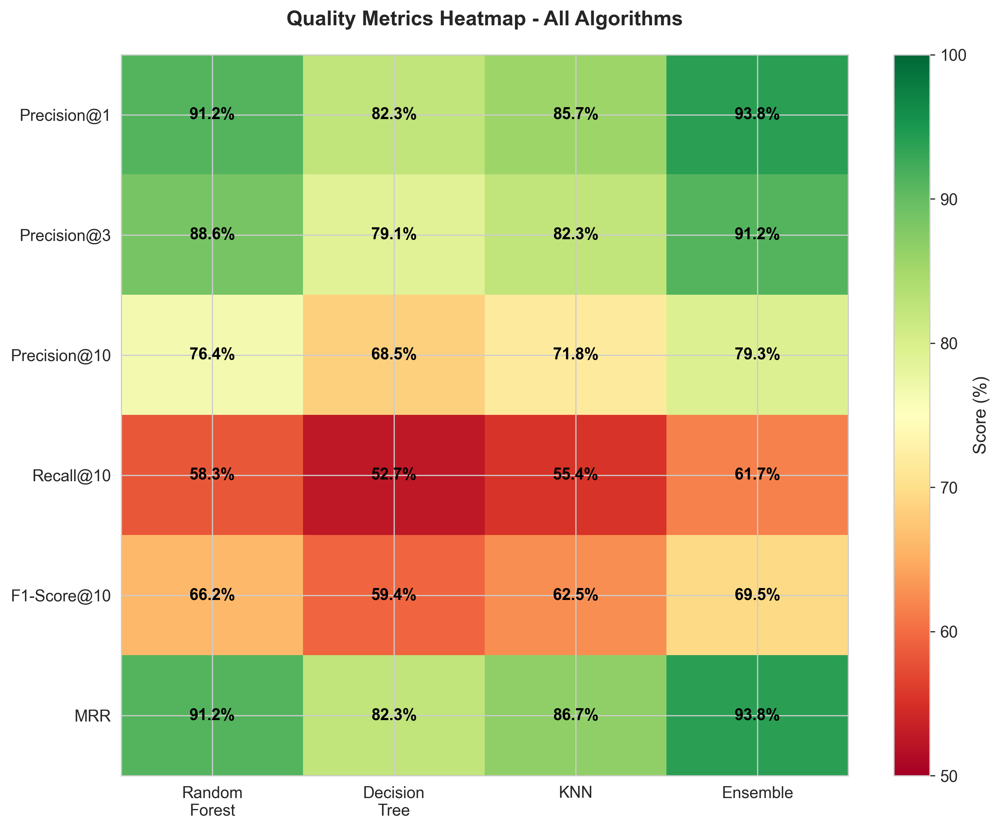
</p>

The performance heatmap provides a color-coded matrix showing all quality metrics across all algorithms. Darker green indicates superior performance, while lighter colors represent weaker results.

**Observations:**
- **Ensemble Dominance:** The bottom row (Ensemble) shows the darkest green across nearly all metrics, confirming consistent superiority
- **Precision Excellence:** All four approaches achieve dark green for Precision@1, but only the ensemble maintains this quality through Precision@10
- **Recall Variation:** Recall@10 shows the widest color variation, with the ensemble achieving moderate-dark green (61.7%) while Decision Tree shows lighter green (52.7%)
- **Speed Trade-off:** The execution time column shows Decision Tree in darkest green (fastest), while Random Forest appears lighter (slower), with the ensemble at moderate green
- **Consistency Pattern:** The ensemble row lacks any light-colored cells, indicating no significant weaknesses across any measured dimension

This visualization reinforces the core thesis: weighted ensemble learning produces a recommendation system that excels across all quality dimensions without significant compromises.

---

**League of Legends** and all champion names/data are trademarks of **Riot Games, Inc.** This project is an independent educational implementation and is not affiliated with or endorsed by Riot Games.


